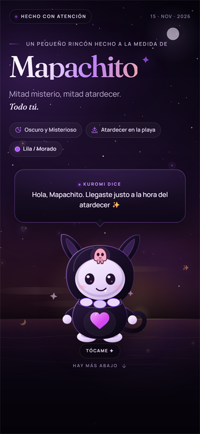
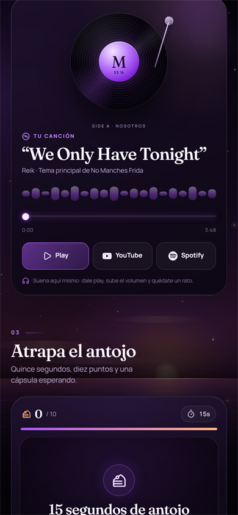
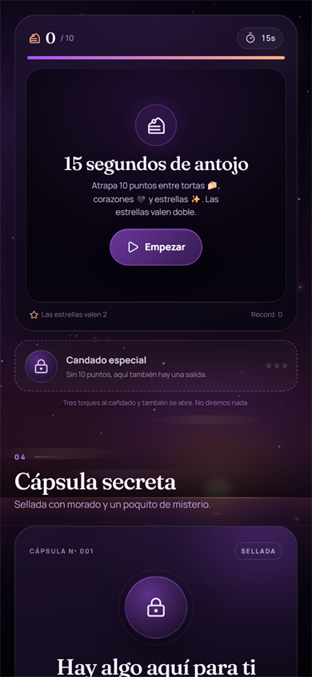

<div align="center">

# 🖤 Mapachito

**Un pequeño rincón web, mobile-first, hecho a la medida de una persona.**

Atardecer en la playa · misterio morado · Kuromi · torta de tres leches · una cápsula secreta.

[](https://react.dev)
[](https://vite.dev)
[](#licencia)

[](https://vercel.com/new/clone?repository-url=https://github.com/Yorlxx/Mapachito)

</div>

---

## ✨ Qué es esto

Una experiencia interactiva de una sola página, pensada primero para el teléfono. No es un formulario ni un currículum: es un regalo digital con atmósfera, pequeños gestos y una sorpresa al final.

| Inicio | Soundtrack | Juego y cápsula |
| :---: | :---: | :---: |
|  |  |  |

## 🎁 Lo que incluye

- **Atmósfera animada en Canvas:** sol de atardecer, brillo del mar, estrellas, luna creciente, estrellas fugaces y partículas flotantes.
- **Kuromi interactiva:** salta al tocarla, lanza corazones y estrellas, y rota cumplidos divertidos con un toque coqueto.
- **Ficha de personaje coleccionable:** tarjeta con inclinación y brillo 3D, superpoder al 100% y un medidor de felicidad que se guarda en el navegador.
- **Lluvia de antojos:** el botón “Enviar antojo” hace caer emojis de torta de tres leches y sube la felicidad.
- **Soundtrack real:** reproduce un MP3 local con vinilo girando, onda animada, play/pausa, barra para adelantar y enlaces directos a YouTube y Spotify.
- **Mini-juego de 15 segundos:** atrapa tortas, corazones y estrellas; las estrellas valen doble.
- **Cápsula secreta:** se abre al llegar a 10 puntos o con tres toques al candado especial. Confeti, texto personal y nota final.
- **Detalles cuidados:** diseño de 360 a 430 px sin scroll horizontal, botones cómodos para el pulgar, transiciones suaves, `prefers-reduced-motion`, controles accesibles y `localStorage` para felicidad y récord.

## 🧰 Stack

| Herramienta | Uso |
| --- | --- |
| [React 19](https://react.dev) | Interfaz y estado |
| [Vite 8](https://vite.dev) | Desarrollo y build |
| [lucide-react](https://lucide.dev) | Iconos |
| [canvas-confetti](https://www.npmjs.com/package/canvas-confetti) | Confeti de la cápsula |
| CSS + Canvas | Atmósfera, animaciones y estilos |

Sin backend, sin base de datos y sin variables de entorno.

## 🚀 Empezar en local

Requisitos: **Node.js 22.12 o superior** y npm.

```bash
git clone https://github.com/Yorlxx/Mapachito.git
cd Mapachito
npm install
npm run dev
```

Abre **http://localhost:5173/** en el navegador. Para probar la vista móvil, activa el modo dispositivo y elige un ancho entre 360 y 430 px.

### Scripts

| Comando | Qué hace |
| --- | --- |
| `npm run dev` | Servidor de desarrollo con recarga en vivo |
| `npm run build` | Build de producción en `dist/` |
| `npm run preview` | Sirve el build de producción en local |

## 🎨 Personalizar

Casi todo el contenido vive en **un solo archivo**: [`src/data/ella.json`](src/data/ella.json).

| Clave | Qué controla |
| --- | --- |
| `apodo` | Nombre que aparece en el hero, la ficha y el footer |
| `color_hex` | Color de acento de toda la app (variable CSS `--accent`) |
| `color_nombre` | Etiqueta del color en los chips |
| `estilo` | Chip de estilo (“Oscuro y Misterioso”) |
| `ambiente` | Chip de ambiente (“Atardecer en la playa”) |
| `personaje_animal` | Nombre del personaje en la ficha |
| `cancion` | Título de la canción |
| `cancion_artista` | Artista mostrado bajo el título |
| `cancion_detalle` | Crédito o descripción de la canción |
| `cancion_archivo` | Ruta del MP3 dentro de `public/` |
| `cancion_youtube` | Enlace directo de YouTube |
| `cancion_spotify` | Enlace directo de Spotify |
| `comida` | Comida del antojo y emojis asociados |
| `superpoder` | Texto del superpoder al 100% |
| `extra` | Texto que revela la cápsula secreta |
| `nota_final` | Nota final dentro de la cápsula |
| `firma` | Firma al cierre de la cápsula |
| `fecha_respuesta` | Fecha mostrada en el footer |

### Cambiar la canción

1. Copia tu archivo a `public/music/` (por ejemplo, `public/music/mi-cancion.mp3`).
2. Actualiza `cancion_archivo` con la ruta: `"/music/mi-cancion.mp3"`.
3. Actualiza `cancion`, `cancion_artista`, `cancion_detalle`, `cancion_youtube` y `cancion_spotify`.

El reproductor lee la duración real del archivo, así que no hay que escribirla a mano.

### Cambiar colores y textos de la interfaz

- El acento sale de `color_hex`; se aplica en tiempo real con `--accent`.
- Los degradados, tamaños y animaciones están en [`src/styles.css`](src/styles.css).
- Los textos de la interfaz (chips, botones, mensajes del juego) están en los componentes de [`src/components`](src/components).

## 🗂️ Estructura

```text
.
├─ docs/                      # Capturas usadas en este README
├─ public/
│  └─ music/
│     └─ we-only-have-tonight.mp3
├─ src/
│  ├─ components/
│  │  ├─ Atmosphere.jsx       # Cielo, mar, luna y partículas
│  │  ├─ CharacterCard.jsx    # Ficha, tilt 3D y medidor de felicidad
│  │  ├─ EmojiRain.jsx        # Lluvia de antojos
│  │  ├─ Mascot.jsx           # Kuromi, salto, frases y partículas
│  │  ├─ MiniGame.jsx         # Juego de 15 segundos y candado
│  │  ├─ SecretCapsule.jsx    # Cápsula bloqueada / abierta
│  │  ├─ SectionHeading.jsx   # Encabezados numerados
│  │  └─ Soundtrack.jsx       # Reproductor de audio
│  ├─ data/ella.json          # Todo el contenido personal
│  ├─ App.jsx                 # Composición y lógica principal
│  ├─ main.jsx                # Punto de entrada
│  ├─ styles.css              # Sistema visual y animaciones
│  └─ utils.js                # Fechas y utilidades
├─ index.html
├─ package.json
├─ vercel.json
└─ vite.config.js
```

## ☁️ Desplegar en Vercel

### Desde la web (recomendado)

1. Entra a [vercel.com/new](https://vercel.com/new) e importa `Yorlxx/Mapachito`.
2. Vercel detecta **Vite** automáticamente.
3. Build command: `npm run build`. Output directory: `dist`.
4. No hay variables de entorno. Pulsa **Deploy**.

También puedes usar el botón de arriba: clona el proyecto en tu cuenta y lo despliega en un solo paso.

### Desde la terminal

```bash
npm install -g vercel
vercel
vercel --prod
```

## 🧑‍💻 Cómo hacer tu propia versión

1. Haz **Fork** de este repositorio (o usa el botón **Use this template** si está disponible).
2. Clona tu fork: `git clone https://github.com/TU-USUARIO/Mapachito.git`.
3. Cambia los datos en `src/data/ella.json`.
4. Reemplaza el MP3 en `public/music/` y actualiza las claves de la canción.
5. Ajusta el color de acento con `color_hex` y, si quieres, los estilos en `src/styles.css`.
6. Prueba en móvil con `npm run dev`.
7. Despliega en Vercel y comparte el enlace.

No necesitas tocar React para cambiar el contenido: el JSON alimenta el hero, la ficha, el soundtrack, el juego y la cápsula.

## ♿ Accesibilidad y detalles técnicos

- Respeta `prefers-reduced-motion`: las animaciones se reducen o desactivan.
- Los botones y el deslizador de la canción tienen etiquetas ARIA y foco visible.
- Objetivos táctiles de al menos 44 px en las acciones principales.
- Sin scroll horizontal comprobado de 320 a 430 px.
- La felicidad y el récord se guardan con `localStorage` (`mapachito-happiness` y `mapachito-best`).
- El MP3 se sirve desde `public/`, con soporte de rangos para adelantar sin descargar todo.

## 🎵 Música y créditos

- **“We Only Have Tonight” — Reik**, tema principal de *No Manches Frida*. La canción y sus derechos pertenecen a sus autores y sellos. Está incluida únicamente como detalle personal; **no** forma parte de la licencia del código.
- Si haces tu propia versión, usa una pista que tengas derecho a distribuir o deja solo los enlaces de YouTube/Spotify. Si el repositorio es público y quieres evitar redistribuir el audio, puedes hacerlo privado o quitar el archivo de `public/music/`.
- La mascota es una ilustración original inspirada en Kuromi (Sanrio). Este proyecto no está afiliado ni avalado por Sanrio.
- Gracias a [React](https://react.dev), [Vite](https://vite.dev), [Lucide](https://lucide.dev) y [canvas-confetti](https://www.npmjs.com/package/canvas-confetti).

## 📄 Licencia

El **código** de este proyecto está bajo la licencia [MIT](LICENSE). Puedes usarlo, modificarlo y compartirlo dando crédito.

Quedan **fuera** de esa licencia: la canción, las marcas mencionadas, los personajes de terceros y cualquier contenido personal de `src/data/ella.json`. Reemplázalos por contenido propio si vas a publicar tu versión.

---

<div align="center">

Hecho con atención, sin prisa y con una rebanada extra de tres leches. 🍰

</div>
